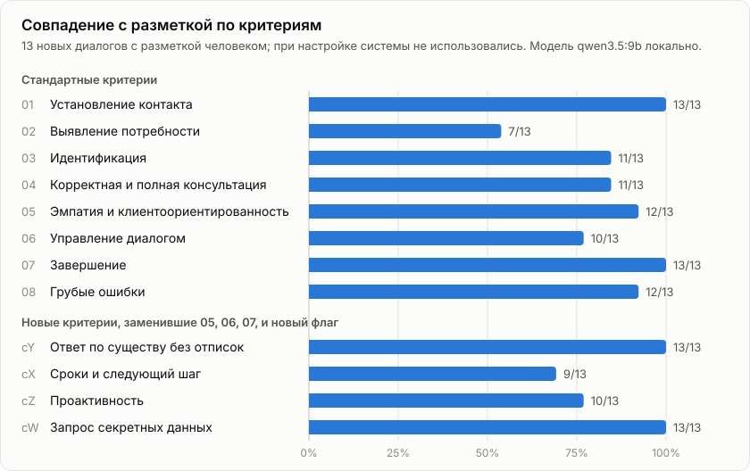
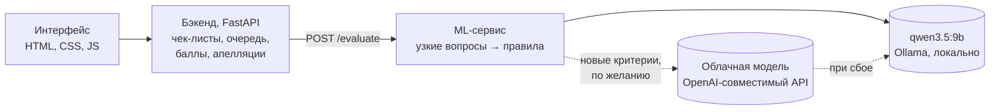

# Maestro — оценка качества диалогов поддержки

Прототип Conversation Quality Analytics для Freedom Broker. Система оценивает работу оператора в чатах и
звонках на русском, казахском и английском по настраиваемому чек-листу и объясняет каждый вывод
репликой из диалога.

**Демо: https://web.drdieb.com** — работает, пока включён ноутбук команды с моделью. Если не открывается,
запустите проект у себя (раздел «Запуск у себя», около 10 минут).

**Команда Maestro:** Aslan Zhumazhanov, Askar Islyamov, Aldiyar Aspandiyar, Bekarys Serikov.

## Коротко

- **По каждому критерию** — ответ, баллы «набрано из возможных», обоснование и реплика-доказательство; для
  пропущенного действия — проверенный участок, для N/A — причина.
- **≈ 85% совпадения с ручной разметкой** на 13 новых диалогах, которых система не видела при настройке.
- **86.5% на четырёх новых критериях**, заменивших 05, 06 и 07: изменённый в интерфейсе критерий сразу
  оценивается по своей формулировке, без доработки кода.
- **Вердикт и баллы считает код, а не модель.** Модель отвечает на узкие вопросы, а цитаты берутся прямо из
  транскрипта, поэтому выдумать доказательство она не может.
- **Локально и в облаке:** основная модель `qwen3.5:9b` работает на ноутбуке, оценка стоит $0. Облачная
  модель подключается переключателем, а при её сбое оценка сама переходит на локальную.
- **Работа с результатом:** апелляции с решением проверяющего, версии чек-листа, подсказка «как можно было
  ответить», аналитика с экспортом.

## Что посмотреть в демо

1. **Оценённый диалог** с раскрытым критерием «Завершение» = «Нет» и критерием с N/A:
   [p1-kz-008](https://web.drdieb.com/#/dialogs/p1-kz-008?crit=c07). Ссылка в обосновании переводит к реплике.
   Под проваленным критерием есть кнопка **«Как можно было ответить»**: модель предложит реплику оператора.
2. **Любой другой диалог** — кнопка «Оценить», 30–40 секунд. Например, грубое нарушение (оператор предлагает
   перевести деньги ему лично): [p1-ru-022](https://web.drdieb.com/#/dialogs/p1-ru-022).
3. **Звонок** с записью и проблемными моментами на аудио-таймлайне:
   [p4-ru-001](https://web.drdieb.com/#/dialogs/p4-ru-001).
4. **Апелляция:** в карточке роль «Оператор» → «Оспорить оценку», затем роль «Проверяющий» → решение с
   причиной → итог пересчитывается, исходная оценка остаётся видна.
5. **Замена критерия:** [«Чек-лист»](https://web.drdieb.com/#/checklists) → изменить критерий → сохранить
   новую версию → «Диалоги» → переоценить.

## Задание → решение

| Пункт задания | Как сделано |
|---|---|
| 01 Чек-лист | Добавление и правка критериев: формулировка, вес, тип ответа, шкала, N/A. Сохранение версий, откат к исходному чек-листу. |
| 02 Оценка диалога | Загрузка JSON или импорт набора по `group_id` из API организаторов. RU, KZ, EN. Реплики бота и системные события — контекст. |
| 03 Результат | Ответ, баллы, вес, обоснование и реплика по каждому критерию; проверенный участок; причина N/A; итог и секции. Грубая ошибка — отдельной отметкой. |
| Вес и итог | Строго по стр. 2 чек-листа: N/A исключается, вес перераспределяется, итог округляется до двух знаков. |
| 04 Карточка | Переход из обоснования к реплике или моменту звонка, встроенный плеер с таймлайном. |
| 05 Апелляция | Выбор критерия и комментарий; проверяющий видит спорную оценку, комментарий и фрагмент диалога. |
| 06 Решение | Подтверждение или изменение с причиной, пересчёт итога; видны исходная оценка, решение и финальный результат. |
| Контроль | Импорт по `group_id`, замена критерия через интерфейс, массовая оценка: 10 диалогов — около 6 минут. |
| Формат | Интерфейс на HTML, CSS и JS без сборки, стили изолированы для встраивания в Dynamics 365 ([проверка встраивания](https://web.drdieb.com/d365-test.html)). |

Сверх задания: подсказка ответа оператору по проваленному критерию, очередь «Требуют внимания», разбор
передач от бота к оператору, интерфейс на RU, EN и KZ, переключение моделей на ходу.

## Точность

<picture>
  <source media="(prefers-color-scheme: dark)" srcset="docs/img/accuracy-dark.svg">
  
</picture>

| Набор | Критерии | Совпадение |
|---|---|---|
| Тестовый: 13 новых диалогов, разметка человеком, при настройке не использовался | 8 стандартных | 85.6% |
| Тот же набор | 4 новых критерия вместо 05, 06, 07 и новый флаг | 86.5% |
| DEV: 19 диалогов, на них настраивались вопросы к модели | 8 стандартных | ≈ 87% |

Эталона организаторов у нас нет, поэтому разметку делала команда по PDF-чек-листу. Самый спорный критерий —
02 «Выявление потребности»: его условие допускает разные прочтения.

## Как устроена оценка



- **Узкие вопросы вместо одного большого.** Каждый критерий разбит на вопросы «да/нет»: «есть ли приветствие в
  первом ответе оператора?», «уточнил ли оператор недостающее до ответа?». Модель видит только нужные реплики,
  сначала пишет рассуждение, потом ответ и номер реплики-доказательства.
- **Вердикт выводит код** по правилам чек-листа. Однозначные случаи решаются вообще без модели: приветствие,
  системное «личность подтверждена», «оператор закрыл чат».
- **Спорные выводы перепроверяются.** Если модель нашла «бессвязную реплику» или «переспрос», отдельный вопрос
  проверяет именно эту реплику: грубость или неверный ответ не должны снижать оценку за ведение диалога.
- **Новый критерий** оценивается общим оценщиком по его тексту: сначала отдельно решается применимость (N/A),
  потом ответ по правилу или шкале.
- **Каждая оценка — живые вызовы модели.** Около 15 вызовов на диалог, результаты не кэшируются; у оценки
  сохраняются модель, время и токены, у каждого вызова — хэш промпта и ответ модели.

## Локально и в облаке

| Режим | Модель | Стоимость одного диалога | Время |
|---|---|---|---|
| Основной | `qwen3.5:9b` через Ollama на ноутбуке (RTX 4070 Laptop, 8 ГБ) | $0 | 30–40 с, около 15 вызовов |
| Облачный (`MAESTRO_BACKEND=openai`) | `gpt-4.1-mini` | ≈ $0.006 со всеми вызовами (34 диалога — $0.20) | около 14 с |
| Гибрид (`MAESTRO_GENERIC_MODEL`) | облачная модель только для новых критериев | зависит от модели | — |

Провайдер переключается в интерфейсе без перезапуска. Если облачная модель недоступна (нет сети, закончилась
оплата), ML-сервис на 10 минут переходит на локальную модель, и оценка не прерывается.

## Запуск у себя

Нужны Docker Desktop, [Ollama](https://ollama.com) и около 10 ГБ на диске. Рекомендуется видеокарта NVIDIA
от 8 ГБ; без неё всё работает, но медленнее — тогда удобнее облачный режим.

```bash
ollama pull qwen3.5:9b

git clone https://github.com/aayafrontenda/secret-maestro-project.git
cd secret-maestro-project
cp ml/.env.example ml/.env              # по умолчанию локальная модель
cp backend/.env.example backend/.env    # ORGANIZER_API_URL — для импорта наборов по group_id

docker compose up -d --build
```

Откройте http://localhost:8000, на странице «Диалоги» загрузите `backend/data/dev_dataset.json` и нажмите
«Оценить» в любом диалоге. Проверка: `curl http://localhost:8000/api/health` должен показать
`"ml": {"provider": "http", "reachable": true}`.

Без Docker: `cd ml && uv sync && uv run maestro serve`, затем бэкенд по [backend/README.md](backend/README.md)
с `ML_PROVIDER=http` и `ML_SERVICE_URL=http://localhost:8001`.

## Ограничения

- Факты о тарифах и процедурах Freedom Broker модель не проверяет: базы знаний нет. Критерий 04 оценивает
  полноту ответа, пропуски и противоречия.
- На пограничных случаях ответы могут немного отличаться между запусками: вычисления на видеокарте не полностью
  детерминированы.
- Тексты обоснований на казахском стоит проверить носителю языка.

## Структура

```
frontend/            интерфейс (HTML, CSS, JS)
backend/             API, хранение, очередь, расчёт баллов, апелляции — backend/README.md
ml/                  сервис оценки, вопросы к модели, правила, замеры — ml/README.md
docs/                контракт фронт ↔ бэк, памятка на день контроля
docker-compose.yml   запуск всего вместе
```
